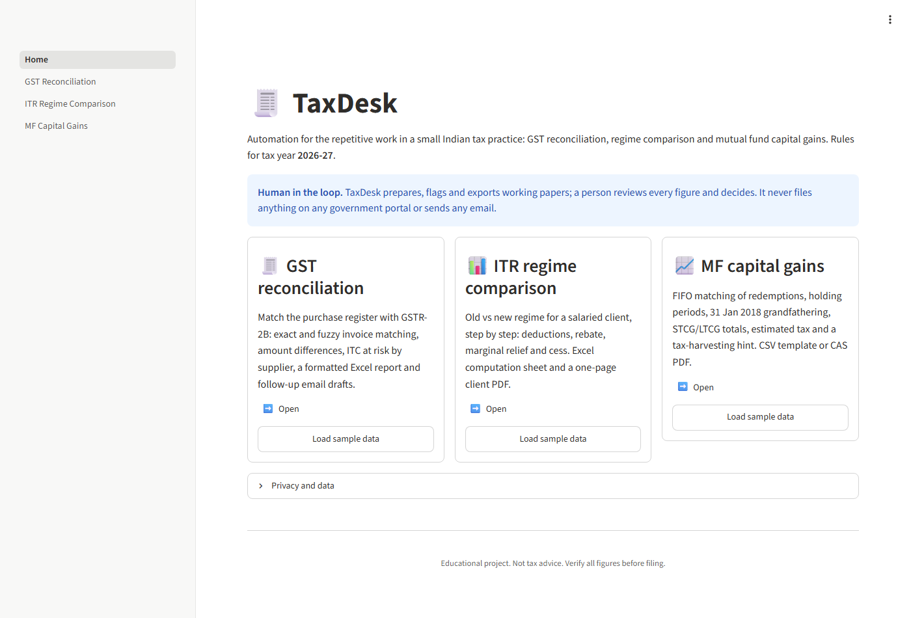
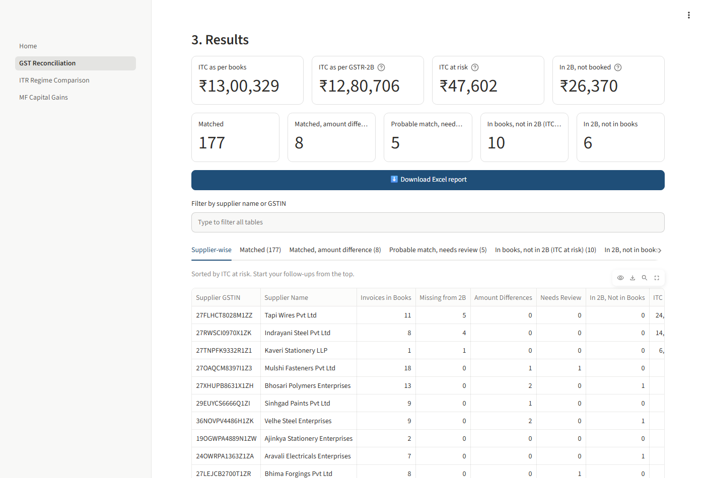
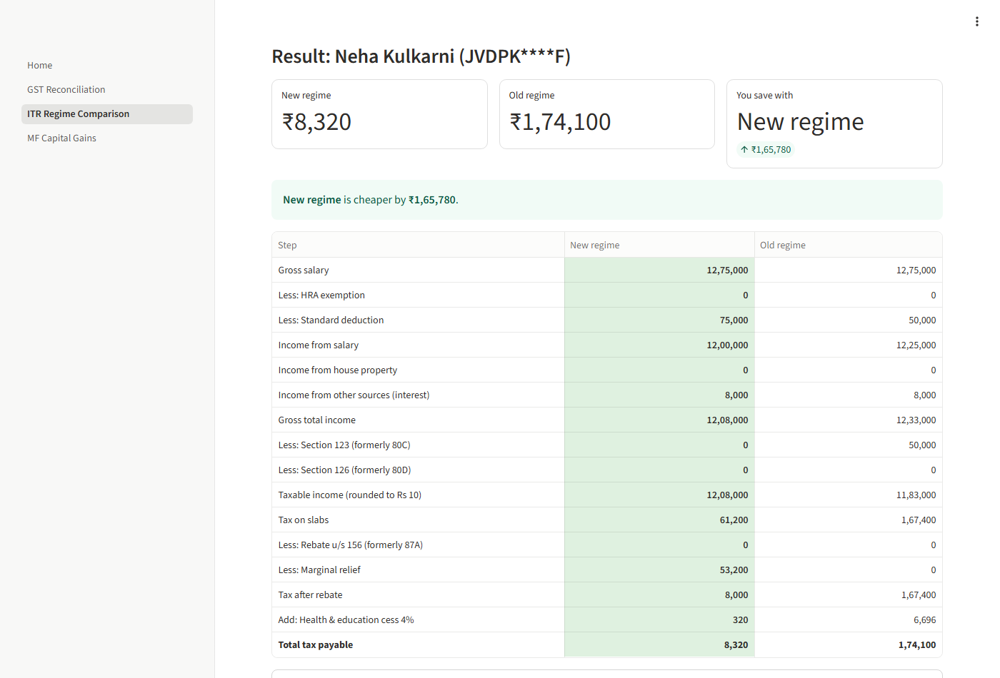
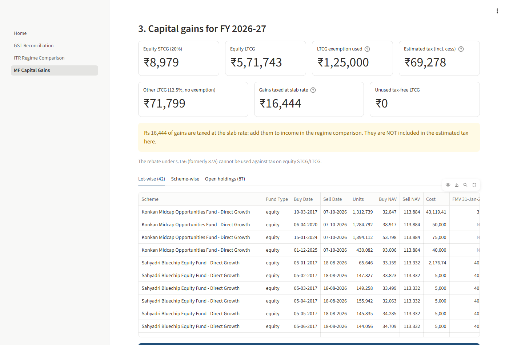
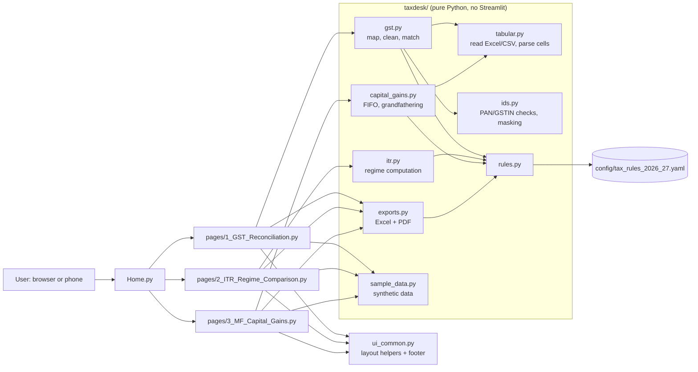

# TaxDesk

**Automation suite for a small Indian tax consultancy**: GST reconciliation (purchase register vs
GSTR-2B), old-vs-new regime comparison for salaried clients, and mutual fund capital gains with FIFO
and grandfathering. Built with Python, pandas and Streamlit.

> **Educational project. Not tax advice. Verify all figures before filing.**
> Uses synthetic data only. The app prepares, flags and exports. It never files anything on any
> government portal and never sends email.

**Live demo:** _add your Streamlit Community Cloud link here after deploying (see [Deploy](#deploy))_

| Home | GST reconciliation |
|---|---|
|  |  |
| **ITR regime comparison** | **MF capital gains** |
|  |  |

---

## Why

During an analyst internship at a tax consultancy, much of the week went into four manual jobs:
matching purchase registers with GSTR-2B, comparing tax regimes for salaried clients, working out
mutual fund capital gains lot by lot, and drafting supplier follow-ups. TaxDesk automates the
preparation and leaves every judgement call to a person.

## Modules

### 1. GST reconciliation
- Upload the purchase register and GSTR-2B (Excel or CSV). Title rows and the portal's two-row merged
  headers are detected automatically; columns are **auto-mapped** and the user confirms them.
- Cleaning: GSTIN format and **check-character** validation, Indian amount formats (`1,23,456.50`,
  `(250)`), day-first dates, blank and total rows skipped. Every bad cell is listed with its row number.
- Matching in order: **exact** (GSTIN + normalised invoice number), then **amount check** per tax head
  (tolerance Rs 1 by default), then **fuzzy** matching (rapidfuzz, similarity >= 90 and amounts within
  tolerance) on what is left.
- Output: Matched, Amount difference, Probable match (review), In books not in 2B (**ITC at risk**),
  In 2B not in books. Supplier-wise risk table, formatted **Excel report**, and **follow-up email
  drafts** per supplier (shown for copying, never sent).
- Speed: 5,200 invoices reconcile in about 0.8 s and 10,400 in about 1.2 s on a laptop.

### 2. ITR regime comparison
- Salaried individual: salary, interest, let-out rent, Section 123 (formerly 80C), Section 126
  (formerly 80D), home-loan interest and HRA exemption.
- Step-by-step computation for both regimes: standard deduction, house property (30% deduction),
  gross total income, deductions, rounding, slab tax, **rebate under s.156 (formerly 87A)**,
  **marginal relief** above Rs 12 lakh, cess. The cheaper regime is highlighted.
- Excel computation sheet (with a "how it is calculated" column and slab working) and a **one-page
  PDF** for the client. PAN is only ever shown masked (`ABCDE****F`).

### 3. Mutual fund capital gains
- Transactions from a CSV/Excel template or a CAMS/KFintech **CAS PDF** (via `casparser`; password
  used once, never stored).
- **FIFO** matching of each redemption against the oldest lots, holding period per lot, and
  classification: equity STCG 20% / LTCG 12.5% above Rs 1.25 lakh; debt bought on or after
  1 Apr 2023 at slab rate; older debt and other funds 12.5% after 24 months.
- **Grandfathering** for equity bought on or before 31 Jan 2018:
  cost = max(actual cost, min(31 Jan 2018 value, sale value)).
- Loss set-off, financial-year filter, estimated tax and a **tax-harvesting hint** (how much LTCG can
  still be booked tax-free, and how many units to redeem given current NAVs).

## Design principles

- **Human in the loop:** the app prepares and flags; a person reviews and decides.
- **Synthetic data only:** `taxdesk/sample_data.py` generates fake suppliers, valid-format GSTINs,
  invoices with planted problems, clients and a 2016-2026 MF history. Tests check that the engine
  finds exactly the planted problems.
- **Privacy:** uploads are processed in memory for the session only (not in Streamlit's shared cache)
  and never written to disk. PANs are masked.
- **One rules file:** every rate, slab, limit and date lives in `config/tax_rules_2026_27.yaml`, with
  the source noted against each value. No rate is hardcoded in the logic.
- **Logic separate from UI:** `taxdesk/` has no Streamlit imports, so the same functions could sit
  behind a FastAPI backend. Pages only lay out widgets.

## Architecture



## Tax rules used (tax year 2026-27)

All values are read from `config/tax_rules_2026_27.yaml`. They were cross-checked on 2026-11-24
against Budget 2026 coverage and the ITA 2025 to ITA 1961 section mapping; check them against the
primary sources named in the YAML before relying on them.

| Rule | Value | Old section (new) |
|---|---|---|
| New regime slabs | 0-4L nil, 4-8L 5%, 8-12L 10%, 12-16L 15%, 16-20L 20%, 20-24L 25%, above 24L 30% | 115BAC (202) |
| New regime standard deduction | Rs 75,000 | |
| New regime rebate | up to Rs 60,000 if total income <= Rs 12 lakh; marginal relief above | 87A (156) |
| Old regime slabs (below 60) | 0-2.5L nil, 2.5-5L 5%, 5-10L 20%, above 10L 30% | |
| Old regime standard deduction | Rs 50,000 | |
| Old regime rebate | up to Rs 12,500 if total income <= Rs 5 lakh | 87A (156) |
| Investments deduction | up to Rs 1,50,000 (old regime) | 80C (123) |
| Health insurance | Rs 25,000 self + Rs 25,000/50,000 parents (old regime) | 80D (126) |
| Home-loan interest, self-occupied | up to Rs 2,00,000 (old regime) | 24(b) |
| House property standard deduction | 30% of net annual value | 24(a) |
| Cess | 4% of tax | |
| Rounding | income and tax to nearest Rs 10 | 288A / 288B |
| Equity MF | STCG 20%; LTCG 12.5% above Rs 1.25 lakh; long term after 12 months | 111A / 112A |
| Grandfathering | equity bought on or before 31 Jan 2018; FMV date 31 Jan 2018 | 112A |
| Debt MF bought on/after 1 Apr 2023 | slab rate, always short term | 50AA |
| Other / older debt MF | 12.5% after 24 months, else slab | 112 |
| GST rates (sample data) | 0 / 5 / 18 / 40% (from 22 Sep 2025) | |

**Out of scope:** surcharge (warning above Rs 50 lakh), senior-citizen slabs, business income,
80TTA and other deductions not listed above.

## Run locally

```bash
python -m venv .venv            # Python 3.11
.venv\Scripts\activate          # Windows   (macOS/Linux: source .venv/bin/activate)
pip install -r requirements.txt
python -m pytest                # 79 tests
python -m taxdesk.sample_data   # writes fake sample files to sample_files/
streamlit run Home.py
```

## Tests

79 pytest tests, including the known-answer cases:

| Case | Expected |
|---|---|
| New regime, salary Rs 12,75,000 | taxable Rs 12,00,000, slab tax Rs 60,000, rebate, **Rs 0** |
| New regime, salary Rs 13,00,000 | taxable Rs 12,25,000, slab tax Rs 63,750, marginal relief to Rs 25,000, **Rs 26,000** |
| Old regime, taxable Rs 10,00,000 | Rs 1,12,500 + cess = **Rs 1,17,000** |
| Equity MF, Rs 3L to Rs 5L after 2 years | LTCG Rs 2,00,000, taxable Rs 75,000, **Rs 9,750** |
| FIFO, 100 @10 + 100 @20, sell 150 @30 | **LTCG Rs 2,000** (100 units), **STCG Rs 500** (50 units) |
| GST synthetic data | exactly 177 / 8 / 5 / 10 / 6 per category, row by row |
| Invoice normalisation | `INV/0042-A` == `inv 42a` |

Also covered: messy files (blank rows, text in number columns, wrong columns), the portal's two-row
header layout, duplicate invoices, a 5,200-row speed test, grandfathering edge cases, loss set-off,
Excel/PDF structure, and headless runs of every page.

## Deploy

1. Push the code to a new GitHub repository (commands in the hand-over notes).
2. Go to [share.streamlit.io](https://share.streamlit.io), sign in with GitHub, click
   **Create app**, pick the repository and branch `main`, set **Main file path** to `Home.py`, open
   **Advanced settings** and choose **Python 3.11**, then **Deploy**.
3. Paste the `*.streamlit.app` link at the top of this README.

## Project structure

```
taxdesk-app/
  Home.py                       home page
  pages/                        one Streamlit page per module (layout only)
  ui_common.py                  shared page setup, footer, table formatting
  taxdesk/
    rules.py                    loads + validates the YAML rules
    ids.py                      PAN/GSTIN/ISIN checks, GSTIN check character, PAN masking
    tabular.py                  in-memory Excel/CSV reading, header detection, cell parsing
    gst.py                      GST mapping, cleaning, matching, summaries, email drafts
    itr.py                      regime computation
    capital_gains.py            FIFO, holding period, grandfathering, set-off, harvesting, CAS import
    exports.py                  Excel and PDF reports
    formatting.py               Indian number format
    sample_data.py              synthetic data generator
  config/tax_rules_2026_27.yaml every rate, slab, limit and date, with sources
  tests/                        pytest suite
  docs/screenshots/             README images
```

## Possible next steps

AIS/26AS reconciliation, a TDS calculator on a payments ledger, Form 16 intake with an LLM plus a
human review screen, and a compliance calendar with reminder drafts.
